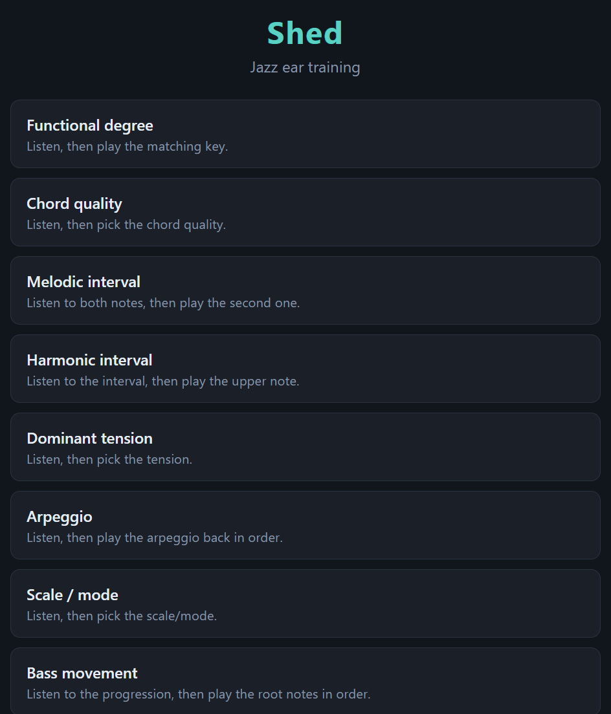
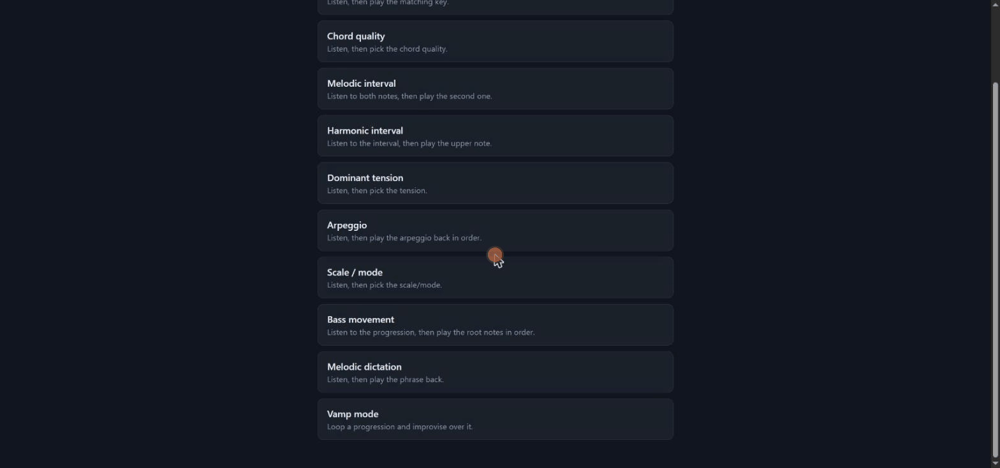

# Shed Web

[](LICENSE.md)

A browser-based jazz ear-training trainer, carrying over the theory core, exercise design and pedagogy of [Shed](https://github.com/Luisnvb/fm1-shed) — originally built for the M-VAVE FM-1 synthesizer — to a standalone web app anyone can use, no hardware required.

Nine exercises: functional degree, chord quality, melodic interval, harmonic interval, dominant tension, arpeggio, scale/mode, bass movement and melodic dictation — plus Vamp mode's ear rounds. Sessions adapt their difficulty to your streak and use spaced repetition to resurface what you keep missing, across all 12 keys. **Vamp mode** loops a chord progression (bass + comping, 5 named vamps) while you improvise over it on an on-screen piano, with chord/scale-tone key guidance (Arpeggio/Scale/Guide/None views) and an "ear" round that quizzes you on what's sounding.





Try it live: **[shed-web.vercel.app](https://shed-web.vercel.app)**

## Stack

- **React + TypeScript + Vite**, no backend — everything runs client-side.
- `src/core/` is a straight TypeScript port of fm1_open's `app/shed/theory.c`, `exercises.c` and `progress.c` (GPL-3.0-only WITH GPL-3.0-linking-exception) — same chord/scale tables, same question generator, same adaptive-difficulty and spaced-repetition logic, same deterministic RNG, same vamp data. `tests/` mirrors the original's host test suite.
- `src/audio/synth.ts` is a small Web Audio synth (not a port of anything — there's no DX7 engine in a browser) that keeps the original's voicing choices (rootless piano voicings, piano/bass registers) so a chord sounds the way the device played it. `src/audio/vampSequencer.ts` is a look-ahead scheduler that loops a vamp indefinitely (the original's player.c instead scheduled only the current + next step, working around the firmware's fixed-size event queue — a browser has no such constraint).
- `src/app/` is the UI: a menu, a per-exercise question screen (an on-screen piano for note/sequence answers, a choice grid for chord/tension/scale picks), feedback, a session summary, and Vamp mode's own screen (polyphonic piano, view switcher, ear round).

## Develop

```
npm install
npm run dev        # http://localhost:5173
npm test            # core logic test suite (vitest)
npm run build        # production build to dist/
```

## License

[GNU GPL v3.0](LICENSE.md). The ported core (`src/core/`) is a derivative work of `app/shed/theory.c`, `exercises.c` and `progress.c` from the upstream [fm1_open](https://github.com/m-vave/fm1_open) / [Shed](https://github.com/Luisnvb/fm1-shed) project, originally licensed GPL-3.0-only WITH GPL-3.0-linking-exception; that exception existed for linking against the FM-1's proprietary binary SDK, which this project has no dependency on, so it's distributed under plain GPL-3.0-only. The rest (audio synth, UI) is original to this project, under the same license.
